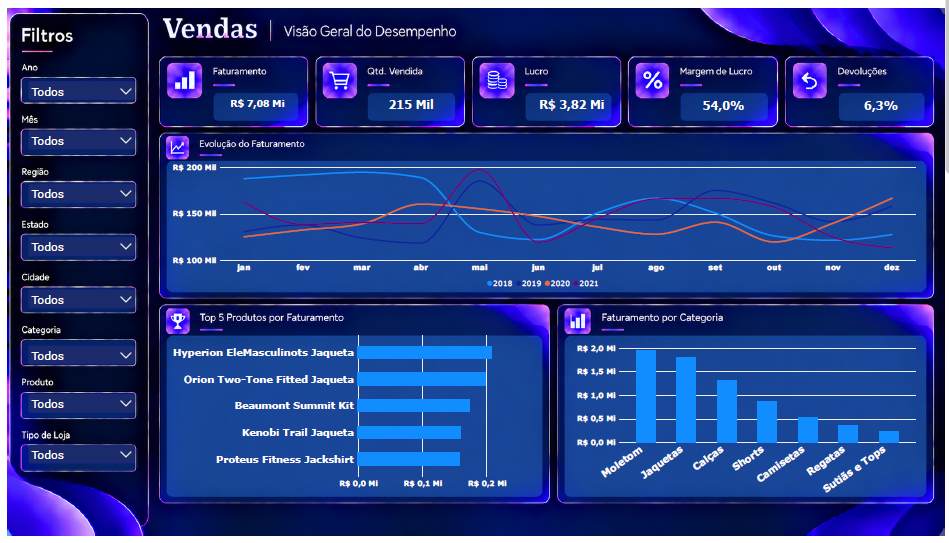
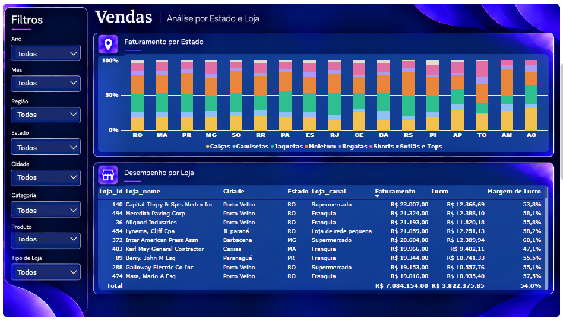

# Dashboard de Vendas | Power BI

Dashboard de vendas de uma marca de roupas esportivas, feito em Power BI para o **Head de Vendas**. Ele responde a três perguntas: **que tipo de venda acontece, quais produtos são mais pedidos e como as vendas se comportam em cada estado**.




## Objetivo

O Head de Vendas já tinha uma visão geral de desempenho. Faltava um detalhamento de:
- quais produtos e categorias vendem mais;
- como as vendas evoluem ao longo do tempo;
- quais categorias de roupa mais vendem em cada estado;
- quais lojas têm melhor desempenho.

## Dados

4 tabelas em Excel:

| Tabela | Conteúdo |
|---|---|
| Vendas | 8.391 vendas (2018 a 2021): data, loja, SKU, quantidade, total, custo, lucro, desconto |
| Produtos | 1.215 SKUs: categoria, gênero, tamanho, cor |
| Lojas | 786 lojas: canal, cidade, região, estado |
| Devolução | Vendas devolvidas, com data e hora |

## Limpeza e tratamento (Power Query)

- Tipos de dados corrigidos e colunas renomeadas.
- Coluna `mes.1` da tabela de devoluções identificada como o **dia** e usada para montar a data da devolução.
- Devoluções duplicadas removidas (mantida a primeira ocorrência).
- Devolução sem venda correspondente identificada com merge anti-join.
- SKUs vendidos que não existiam no cadastro foram incluídos na tabela de produtos (tabela auxiliar *Produtos_Faltantes*, acrescentada com *Append*), evitando categoria em branco nos gráficos.
- Tabelas auxiliares com carga desabilitada.

## Modelo de dados

Modelo estrela, com **Vendas** como tabela fato ligada às dimensões **Produtos**, **Lojas**, **Calendário** (criada em DAX) e **Devolução**. As medidas ficam em uma tabela própria, **Medidas**.

```DAX
Faturamento        = SUM(Vendas[Venda_Total])
Quantidade Vendida = SUM(Vendas[Venda_QTD])
Lucro              = SUM(Vendas[Lucro])
Margem de Lucro    = DIVIDE([Lucro], [Faturamento])
Taxa de Devolução  = DIVIDE(COUNTROWS('Devolução'), COUNTROWS(Vendas))
```

## O dashboard

**Página 1: Visão Geral**
- 5 KPIs: Faturamento, Quantidade Vendida, Lucro, Margem de Lucro e Devoluções.
- Evolução do faturamento ao longo do ano (uma linha por ano).
- Top 5 produtos por faturamento.
- Faturamento por categoria.

**Página 2: Análise por Estado e Loja**
- Composição de faturamento por categoria em cada estado (colunas 100% empilhadas).
- Tabela de desempenho por loja (faturamento, lucro e margem).

**Filtros (sincronizados nas duas páginas):** Ano, Mês, Região, Estado, Cidade, Categoria, Produto e Tipo de Loja.

## Principais insights

Período: jan/2018 a dez/2021 · Faturamento R$ 7,08 Mi · Lucro R$ 3,82 Mi · Margem 54,0%.

- **Moletom e Jaquetas somam 53% do faturamento.** Camisetas vendem 35 mil peças, mas só 7,6% da receita (ticket baixo).
- **A venda é concentrada:** RO e MA somam 45% do faturamento, e a Região Norte responde por 42%.
- **O mix muda por estado:** Moletom domina no Sul (RS 33%, SC 32%, PR 30%) e Jaquetas lideram no Sudeste (RJ 31%, ES 27%).
- **O faturamento é estável, com leve queda:** 2021 recuperou 4,8% sobre 2020, mas ficou 4,8% abaixo de 2018. A sazonalidade é fraca.
- **A margem é quase igual em todo lugar (53 a 55%).** O desconto é a principal alavanca: vendas sem desconto têm margem de 59,3%, contra 50,6% com desconto, e a taxa de devolução é a mesma nos dois grupos.
- **Franquias são o maior canal (36%)** e também têm a maior taxa de devolução (6,9%).

### Recomendações
- Revisar a política de desconto, que tem o maior potencial de ganho de margem.
- Proteger Moletom e Jaquetas e usar Camisetas como produto de entrada.
- Ajustar estoque por região: mais Moletom no Sul, mais Jaquetas no Sudeste.
- Reduzir a dependência de RO e MA com ações em PR, MG e SC.
- Investigar as devoluções nas Franquias.

### Limitações
Estados como AC, AM, AP e TO têm menos de 100 vendas no período, então percentuais neles variam muito. O mix por estado mostra associação, não causa.

## Ferramentas

Power BI Desktop · Power Query (M) · DAX · Excel

## Arquivos

- `Dashboard_Vendas.pbix`: arquivo do Power BI
- `imagens/`: prints das páginas do dashboard
- `dados/`: planilhas originais

## Autora

[Seu nome] · [LinkedIn] · [E-mail]
